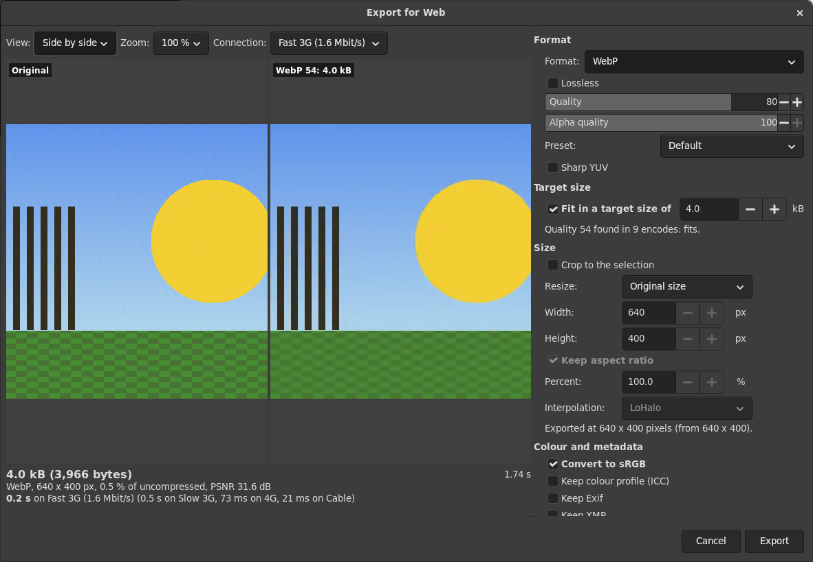
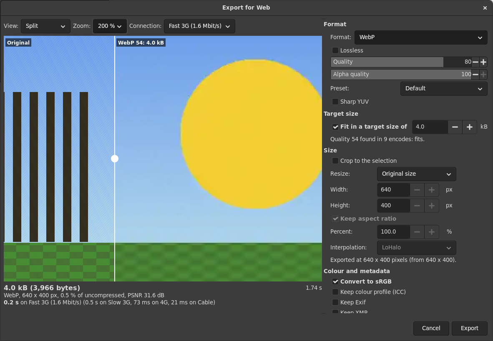

# Save for Web for GIMP 3

**File > Export for Web...**: one dialog to choose a web format and its
settings while you look at the real result. Every change is encoded with
GIMP's own exporter and decoded again with GIMP's own loader, so the
preview shows the very pixels a browser will show, the size shown is the
size of the file to the byte, and Export writes exactly those bytes.

After [Save for Web](https://github.com/auris/gimp-save-for-web) by
Aurimas Juška, number 2 of the old GIMP registry, which never reached
GIMP 3. This is a rewrite in Python 3 for GIMP 3.2, not a port: no code
of the original is used (why: [PLAN.md](PLAN.md)).

## What it does

- **Formats**: JPEG, PNG (24 and 32 bit), PNG-8 (indexed), WebP, AVIF,
  JPEG XL and GIF, each with GIMP's own exporter (`file-jpeg-export`,
  `file-png-export`, `file-webp-export`, `file-heif-av1-export`,
  `file-jpegxl-export`, `file-gif-export`). A format whose exporter this
  GIMP lacks is left out of the list.
  - JPEG: quality, progressive, chroma subsampling (4:2:0, 4:2:2, 4:4:0,
    4:4:4), optimised Huffman tables, smoothing; transparent pixels are
    flattened on a matte (white, black or GIMP's background colour).
  - PNG: compression level, interlacing; 8 bits per channel always, the
    alpha channel only if some pixel is not opaque.
  - PNG-8 and GIF: optimum palette of 2 to 256 colours, the web palette,
    black and white, or the image's own palette (indexed images);
    dithering none, Floyd-Steinberg, Floyd-Steinberg with reduced
    bleeding, positioned; dithered transparency; unused colours removed.
    The conversion is GIMP's own, on a duplicate.
  - WebP: lossy or lossless, quality, alpha quality, the encoder preset,
    sharp YUV.
  - AVIF: lossy or lossless, quality, YUV 4:2:0, 4:4:4 or RGB, encoder
    speed.
  - JPEG XL: lossy or lossless, a quality of 1 to 100 mapped to the
    Butteraugli distance exactly as libjxl's `cjxl -q` does (90 is
    distance 1.0, "visually lossless"), effort 1 to 9.
- **Preview**: the result alone, side by side with the original, split
  with a divider you drag (as in Squoosh), or the original alone. Zoom
  fit or 25 to 800 %, drag to pan (both sides move together), the wheel
  to scroll, Ctrl+wheel to zoom. The "original" is what went into the
  encoder: after the crop, the resize and the conversion to sRGB, so the
  comparison shows only what the encoding does.
- **Read-out**: the file size (kB of 1000 bytes and the exact byte
  count), its share of the uncompressed size, the PSNR against the
  original, and the download time on a connection you choose (slow 3G,
  fast 3G, 4G, cable, 56k modem; latency plus transfer) with three
  others for comparison.
- **Target size**: finds the highest quality (JPEG, WebP, AVIF, JPEG XL)
  or the largest number of colours (PNG-8, GIF) whose file fits in the
  size you give, by bisection (up to 10 encodes). It says so when even
  the lowest does not fit, and when the format has nothing to search
  (PNG-24, lossless modes, fixed palettes).
- **Size**: resize by width and height (with or without the aspect
  ratio) or by percent, with GIMP's interpolations (none for pixel art,
  linear, cubic, NoHalo, LoHalo); crop to the selection's bounding box.
- **Colour and metadata**: by default everything is stripped and the
  image converted to sRGB. You can keep Exif, XMP, IPTC, the colour
  profile and the comment, each on its own, and remove the GPS location
  from the kept Exif and XMP. The switches a format cannot honour are
  greyed out (see "What each format keeps").
- **Your image is never changed**: all work is done on a duplicate of its
  visible layers (hidden layers are left out, masks applied, layers at
  offsets placed), which is deleted afterwards. Its selection stays and
  it is not marked as changed.
- **Remembers** your last settings, the view, the zoom, the connection,
  the dialog's size and the folder you exported to.

### What each format keeps

Measured with GIMP 3.2.6 (the tests check this on every run):

| Keep | JPEG | PNG, PNG-8 | WebP | AVIF | JPEG XL | GIF |
|---|---|---|---|---|---|---|
| Exif | yes | yes | yes | yes | yes | no |
| XMP | yes | yes | yes | yes | yes | no |
| IPTC | yes | yes | no (1) | no | no | no |
| Colour profile | yes | yes | yes | always (2) | (3) | no |
| Comment | yes | yes | no | no | no | no |

1. `file-webp-export` takes an `include-iptc` switch but writes no IPTC:
   WebP has no place for it.
2. `file-heif-av1-export` has no switch for the profile and always
   writes one; after "Convert to sRGB" that is an sRGB profile.
3. The exporter has no switch, and needs none: the colour space is part
   of a JPEG XL codestream. GIMP loads the file converted to sRGB and
   shows no profile; the colours are right also without "Convert to
   sRGB" (tested with an Adobe RGB image; a lossy JPEG XL is even the
   same bytes with or without the conversion).

GIMP adds its own Exif fields (Software, DateTime, the pixel size) when
Exif is kept.

## Install

The four files in `save-for-web/` go into a folder named `save-for-web`
in GIMP's plug-in folder, and `save-for-web.py` must be executable. Then
restart GIMP.

**Linux, GIMP from your distribution or the Flatpak** (the Flatpak uses
the same folder: it has access to `~/.config/GIMP`):

    mkdir -p ~/.config/GIMP/3.2/plug-ins/save-for-web
    cp save-for-web/*.py ~/.config/GIMP/3.2/plug-ins/save-for-web/
    chmod +x ~/.config/GIMP/3.2/plug-ins/save-for-web/save-for-web.py

**Windows** (`%APPDATA%\GIMP\3.2\plug-ins\save-for-web\`) and **macOS**
(`~/Library/Application Support/GIMP/3.2/plug-ins/save-for-web/`): copy
the four files there. These are GIMP's usual folders; the plug-in was not
tried on either system.

It needs GIMP 3.2 with its Python 3 support (part of GIMP 3 and of the
Flatpak); tested with GIMP 3.2.6 (Flatpak). GIMP 3.0 was not tried.

## From scripts

Every setting is an argument of the procedure `plug-in-save-for-web`, so
it also works without the dialog (run mode non-interactive), for example
from the Python console:

    proc = Gimp.get_pdb().lookup_procedure('plug-in-save-for-web')
    c = proc.create_config()
    c.set_property('run-mode', Gimp.RunMode.NONINTERACTIVE)
    c.set_property('image', image)
    c.set_property('file', Gio.File.new_for_path('/tmp/out.webp'))
    c.set_property('format', 'webp')
    c.set_property('target-size', True)
    c.set_property('target-kb', 50.0)
    r = proc.run(c)
    # r.index(1) file size in bytes, 2 and 3 width and height,
    # 4 the quality found (-1 without a target), 5 whether it fits,
    # 6 a note

The names and ranges are in `save-for-web/sfw_model.py` (`SETTINGS`), or
in GIMP's Help > Procedure Browser.

## Speed

The preview waits for a real encode and decode. On a 4000 x 3000 image
(12 megapixels; the test machine, measured by `tests/run.sh`): JPEG,
WebP, AVIF and JPEG XL 1.0 to 1.2 s to encode and 0.3 to 0.5 s to decode;
PNG 2.9 s; PNG-8 4.8 s (the colour conversion); GIF 0.7 s. PNG
compression 9 is the exception: on a noisy 12-megapixel image it took
34.9 s against 2.5 s at 6, for 13 % fewer bytes, which is why the default
is 6. A target-size search multiplies the time by its up to 10 encodes;
the dialog stays responsive between them.

## Tests

    tests/run.sh                   everything
    SFW_GUI=0 tests/run.sh         without the dialog tests
    SFW_ONLY=target tests/run.sh   only the GIMP cases with "target" in the name

1. `tests/unit.py`: the settings, sizes, JPEG XL distance, the bisection,
   download times (57 checks, no GIMP).
2. `tests/gimp-test.py` in a headless GIMP: seven generated test images
   (a synthetic photo, transparency, layers with a hidden one and a mask,
   grey, indexed, 16-bit Adobe RGB with Exif, GPS, XMP, IPTC and a
   comment, pixel art) exported 187 times through the procedure: every
   format on every image, each option, resizing, cropping, target sizes,
   the metadata matrix of the table above. Then: each test image is
   unchanged (pixels of every layer and mask, size, type, precision,
   profile, metadata, parasites, selection, clean), no image is left
   open, no temporary file is left.
3. `tests/check.py` outside GIMP (561 checks): each file decodes with
   ImageMagick (JPEG XL, which this ImageMagick cannot read, with GIMP),
   its size is the size the procedure returned, its header says what was
   asked (progressive, sampling factors, PNG colour type, bit depth,
   palette length, interlacing, WebP VP8 or VP8L, the AVIF and JPEG XL
   signatures), settings that only change the size give the same pixels,
   the target sizes fit (and for JPEG, quality+1 would not), the metadata
   is there or not as chosen (read from the file structure by
   `tests/fileinfo.py`, and compared with what ImageMagick and GIMP
   read), a kept Adobe RGB profile comes back, the conversion to sRGB
   gives GIMP's own converted pixels (and JPEG XL keeps the right colours
   without it), and the preview's decoded pixels are those of the
   written file.
4. `tests/gui/gui-test.sh`: the dialog in the Flatpak GIMP on a Broadway
   display, driven by a headless Chrome (gimp-devtools `gui/cdp.mjs`),
   three times with one throwaway profile: WebP at a 4 kB target through
   the menus and fields, then the same bytes again from the remembered
   settings, then PNG-8 cropped to the selection (23 checks, screenshots
   in `tests/output/gui/`).

GIMP always runs isolated (`tests/isolate.sh`, a copy of gimp-devtools'
`isolate.sh`): a throwaway profile and home under `tests/output`, and a
listing of your own GIMP, Blender, Godot, Krita and Tiled folders before
and after, which must not change. The GUI GIMP runs with
`--new-instance`. The test images are generated; no photos are used.

Needs for the tests: the GIMP 3.2 Flatpak (or a native GIMP 3.2 with
`GIMP_FLATPAK=0`), Python 3 with NumPy, ImageMagick 7 (`magick`), and for
the dialog tests Google Chrome or Chromium, node 22 and
`../gimp-devtools` (or `GIMP_PLUGIN_DEVTOOLS`).

## Not (yet) there

- Animated GIF and WebP, APNG.
- JPEG 2000 (the original had a button for it with nothing behind it).
- Cropping by dragging handles in the preview (the original had them);
  here the crop is the selection's bounding box.
- The original's navigation pop-up; translations (the original had 12).
- Bit depths above 8 for AVIF and JPEG XL, CMYK JPEG.
- A single long encode (PNG compression 9 on a big image) blocks the
  dialog until it is done.

## Licence

GPL-3.0-or-later, see [COPYING](COPYING). Copyright 2026 David.
